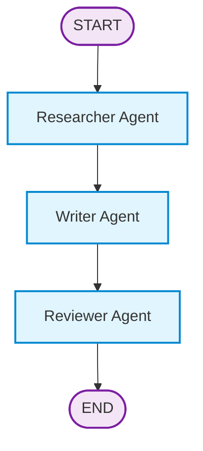

# LangGraph State and Workflow Designer

An academic, agentic workflow built using **LangGraph**, **LangChain**, and local **Ollama** LLMs implementing a fixed sequential three-agent pipeline with both a **CLI** and an interactive **Streamlit Browser UI**:

$$\text{START} \longrightarrow \text{Researcher} \longrightarrow \text{Writer} \longrightarrow \text{Reviewer} \longrightarrow \text{END}$$

---

## 1. Project Overview

The **LangGraph State and Workflow Designer** is a modular Python application that demonstrates stateful multi-agent orchestration. The workflow coordinates three specialized LLM agents in a strict sequence:
1. **Researcher Agent**: Gathers factual evidence and key findings for a given topic from the local LLM.
2. **Writer Agent**: Transforms the research evidence into a coherent, three-part structured answer (Introduction, Explanation, Conclusion).
3. **Reviewer Agent**: Evaluates the draft for relevance, clarity, factual consistency, and structure, assigning a numerical score ($1\text{ to }10$) and constructive feedback.

All three agents share data through a single, centralized **LangGraph shared state** (`WorkflowState`). Users can interact with the workflow through either the command-line interface (`app/main.py`) or a modern browser-based dashboard (`app/ui.py`).

> [!NOTE]
> **Academic Note on Research Evidence**: All research evidence in this application is **model-generated knowledge** produced by the local Ollama LLM (`llama3.2:1b`). The application does not use internet browsing, search engines, or external web scraping.

---

## 2. Problem Statement

Manual research, writing, and editorial review can be fragmented and repetitive. In traditional multi-agent systems, passing complex data between autonomous agents often leads to:
- State desynchronization or schema mismatches.
- Uncontrolled circular loops or infinite revision cycles.
- High cost and privacy risks associated with commercial cloud APIs.

This project addresses these challenges by implementing a deterministic, fixed sequential pipeline with strict state schemas, zero external API costs, complete data privacy, and predictable execution.

---

## 3. Objectives

- Design a sequential multi-agent workflow using **LangGraph** (`StateGraph`, `START`, `END`).
- Implement a centralized `TypedDict` shared state (`WorkflowState`) with exactly 7 tracked fields.
- Integrate a local, privacy-preserving LLM using **Ollama** (`llama3.2:1b`) via `langchain-ollama`.
- Enforce strict node contracts: each node updates only the fields it is responsible for.
- Provide robust score extraction and fallback mechanisms for reviewer evaluation.
- Provide both a terminal CLI and a professional, responsive **Streamlit** browser UI.
- Implement comprehensive file and console logging to track node transitions and errors.
- Deliver a suite of isolated unit tests (using mocked LLM responses) and optional live integration tests.

---

## 4. Technologies Used

- **Language**: Python 3.12+ (verified on 3.12.6)
- **Agent Orchestration**: [LangGraph](https://github.com/langchain-ai/langgraph) (`langgraph>=1.2.0`)
- **LLM Abstraction**: [LangChain Core](https://github.com/langchain-ai/langchain) (`langchain-core>=1.8.0`)
- **Local Model Provider**: [Ollama](https://ollama.com/) & `langchain-ollama>=1.1.0`
- **Default Model**: `llama3.2:1b`
- **Browser UI**: [Streamlit](https://streamlit.io/) (`streamlit>=1.30.0`)
- **Configuration**: `python-dotenv>=1.0.0`
- **Testing Framework**: `pytest>=8.0.0`
- **Visualization**: Mermaid flowchart diagrams

---

## 5. Core Concepts: Graph, Node, Edge, and State

To understand LangGraph architecture for an evaluator or developer:

| Concept | Simple Explanation | Implementation in this Project |
|---|---|---|
| **Graph** | The overarching container that manages the workflow, registers nodes and edges, and compiles into an executable runtime. | `workflow = StateGraph(WorkflowState)` in `app/graph.py` |
| **State** | A centralized data structure (blackboard) that holds the cumulative context across the entire workflow execution. | `WorkflowState` (`TypedDict`) in `app/state.py` |
| **Node** | An individual python function representing an agent or processing step. It inspects current state and returns updates. | `researcher_node`, `writer_node`, `reviewer_node` in `app/nodes.py` |
| **Edge** | A directed transition connecting one node to the next, determining the execution sequence. | `workflow.add_edge("researcher", "writer")` in `app/graph.py` |

---

## 6. Architecture & Workflow

### Workflow Sequence



1. **START $\rightarrow$ Researcher Node**:
   - Reads `topic` from shared state.
   - Generates factual, objective evidence using Ollama.
   - Updates `evidence` and sets `status = "research_completed"`.
2. **Researcher $\rightarrow$ Writer Node**:
   - Reads `topic` and `evidence` from shared state.
   - Generates a 3-part structured draft (Introduction, Explanation, Conclusion).
   - Updates `draft` and sets `status = "writing_completed"`.
3. **Writer $\rightarrow$ Reviewer Node**:
   - Reads `topic`, `evidence`, and `draft` from shared state.
   - Evaluates the draft for relevance, clarity, consistency, and completeness.
   - Extracts feedback and validates a numeric score between 1 and 10.
   - Updates `feedback`, `score`, `revision_count = 0`, and sets `status = "completed"`.
4. **Reviewer $\rightarrow$ END**:
   - Graph execution terminates and returns the complete final state.

---

## 7. Shared State Specification

Defined in `app/state.py` as `WorkflowState`:

| Field Name | Type | Description | Initial Value | Updated By |
|---|---|---|---|---|
| `topic` | `str` | User-supplied research topic | User Input | Initialized by CLI / UI |
| `evidence` | `str` | Research findings & key facts | `""` | `researcher_node` |
| `draft` | `str` | Generated structured answer | `""` | `writer_node` |
| `feedback` | `str` | Constructive critique & evaluation | `""` | `reviewer_node` |
| `score` | `int` | Review score ($1 \text{ to } 10$) | `0` | `reviewer_node` |
| `revision_count` | `int` | Number of revisions executed | `0` | `reviewer_node` (set to 0) |
| `status` | `str` | Workflow execution status | `"initialized"` | Each node sequentially |

---

## 8. Agent Responsibilities

### 1. Researcher Agent (`app/nodes.py`)
- **Input**: `state["topic"]`
- **Output**: `{"evidence": ..., "status": "research_completed"}`
- **System Instructions**: Gathers clear, factual, concise evidence without fabricating statistics, citations, or references.

### 2. Writer Agent (`app/nodes.py`)
- **Input**: `state["topic"]`, `state["evidence"]`
- **Output**: `{"draft": ..., "status": "writing_completed"}`
- **System Instructions**: Produces a coherent, academic draft strictly using the provided evidence, dividing the output into:
  1. *Introduction*
  2. *Explanation*
  3. *Conclusion*

### 3. Reviewer Agent (`app/nodes.py`)
- **Input**: `state["topic"]`, `state["evidence"]`, `state["draft"]`
- **Output**: `{"feedback": ..., "score": ..., "revision_count": 0, "status": "completed"}`
- **Evaluation Criteria**: Relevance, clarity, factual consistency with the evidence, coverage, and organization.
- **Score Parsing**: Extracts integer scores, validates that $1 \le \text{score} \le 10$, applies bounds clamping, and ensures no review remarks or rationale are truncated.

---

## 9. Project Directory Structure

```
TYL-Assignment2/
├── app/
│   ├── __init__.py           # Application package & logging configuration
│   ├── state.py              # TypedDict WorkflowState schema definition
│   ├── llm.py                # ChatOllama configuration & singleton factory
│   ├── nodes.py              # Researcher, Writer, and Reviewer node functions
│   ├── graph.py              # StateGraph definition, compilation & mermaid export
│   ├── main.py               # CLI entry point, user input handling & output rendering
│   └── ui.py                 # Streamlit web UI dashboard & execution visualizer
├── tests/
│   ├── __init__.py           # Tests package
│   ├── test_workflow.py      # Core unit tests (mocked LLM) & integration test
│   └── test_ui.py            # Streamlit UI integration & streaming tests
├── diagrams/
│   └── workflow.mmd          # Mermaid workflow diagram source
├── logs/
│   ├── .gitkeep              # Git keepfile
│   └── workflow.log          # Runtime application logs (timestamps & log levels)
├── .env                      # Local environment configuration (git-ignored)
├── .env.example              # Environment variable template
├── .gitignore                # Git ignore rules
├── pytest.ini                # Pytest configuration and marker declarations
├── requirements.txt          # Project dependencies (including Streamlit)
└── README.md                 # Complete project documentation
```

---

## 10. Installation & Setup (Windows PowerShell)

### Prerequisites
- Windows 10/11
- Python 3.12 (verified on 3.12.6)
- Ollama installed on the system

### 1. Navigate to Project Directory
```powershell
cd c:\Users\shanu\OneDrive\Desktop\TYL-Assignment2
```

### 2. Activate Virtual Environment
```powershell
.\.venv\Scripts\Activate.ps1
```
*(If PowerShell restricts script execution, run `Set-ExecutionPolicy -Scope Process -ExecutionPolicy Bypass` first).*

### 3. Install Dependencies
```powershell
pip install -r requirements.txt
```

### 4. Ollama Setup & Model Download
Ensure the Ollama application is running. In a PowerShell terminal, pull the required model:
```powershell
ollama pull llama3.2:1b
```
Verify the model is downloaded:
```powershell
ollama list
```

### 5. Environment Variables
Copy `.env.example` to `.env` (already created):
```powershell
Copy-Item .env.example .env
```
Contents of `.env`:
```ini
OLLAMA_MODEL=llama3.2:1b
OLLAMA_BASE_URL=http://localhost:11434
```

---

## 11. How to Run the Applications

### Option A: Interactive Browser UI (Streamlit)
Launch the Streamlit web dashboard:
```powershell
streamlit run app/ui.py
```
Open your browser and navigate to:
```
http://localhost:8501
```

**UI Features:**
- **Visual Pipeline Header**: Visual representation of `START -> Researcher -> Writer -> Reviewer -> END`.
- **Live Agent Progress**: Real-time progress bar and status updates as each agent executes.
- **KPI Summary Cards**: Topic, Status, Review Score ($X / 10$), and Revisions.
- **Clean Expandable Sections**:
  - `🔬 Researcher Output: Factual Evidence`
  - `✍️ Writer Output: Structured Draft`
  - `🧐 Reviewer Output: Evaluation & Score`
  - `📋 Final Workflow State: Raw Shared Blackboard`
- **Sidebar Diagnostics**: Real-time Ollama status indicator and Mermaid topology viewer.

---

### Option B: Command-Line Interface (CLI)

#### Interactive CLI Mode:
```powershell
python -m app.main
```

#### CLI Argument Mode:
```powershell
python -m app.main --topic "Binary Search Algorithm"
```

---

## 12. How to Run Tests

### Standard Unit Tests (Fast & Offline, 24 Tests)
All unit tests use mocked LLM responses and do **not** require a running Ollama server:
```powershell
python -m pytest -v -m "not integration"
```

### Run Full Test Suite:
```powershell
python -m pytest -v
```

### Optional Live Integration Test (Requires Running Ollama):
```powershell
python -m pytest -v -m integration
```
*(If Ollama is not reachable, this test automatically skips cleanly without breaking the build).*

---

## 13. Workflow Diagram Visualization

The workflow topology is captured in `diagrams/workflow.mmd`.

### Dynamic Generation via LangGraph
You can inspect the Mermaid representation generated directly from the compiled graph:
```powershell
python -c "from app.graph import get_mermaid_diagram; print(get_mermaid_diagram())"
```

---

## 14. Logging

All application operations, node transitions, and exceptions are logged to:
```
logs/workflow.log
```
Log format includes:
- Timestamp: `YYYY-MM-DD HH:MM:SS`
- Log Level: `[INFO]`, `[WARNING]`, `[ERROR]`
- Module Name: e.g. `app.main`, `app.nodes`, `app.ui`
- Message: Node entry/exit, output summary, score, and error traces.

---

## 15. Evaluation Demonstration Guide

When demonstrating this project to a college evaluator:

1. **Streamlit UI Demonstration**:
   - Run `streamlit run app/ui.py`.
   - Show the browser interface at `http://localhost:8501`.
   - Enter a topic (e.g., `"Dijkstra's Algorithm"`) and click **Run Workflow**.
   - Watch the live execution status track through the Researcher, Writer, and Reviewer nodes.
   - Expand each deliverable to demonstrate clean state separation and the final 7-field shared state blackboard.
2. **CLI Demonstration**:
   - Run `python -m app.main --topic "Binary Search Algorithm"`.
   - Show the sequential execution in the terminal and inspect `logs/workflow.log`.
3. **Automated Testing**:
   - Run `python -m pytest -v -m "not integration"`.
   - Show that 24 unit tests cover node output isolation, score parsing, graph edges, and UI streaming in under 2 seconds.
